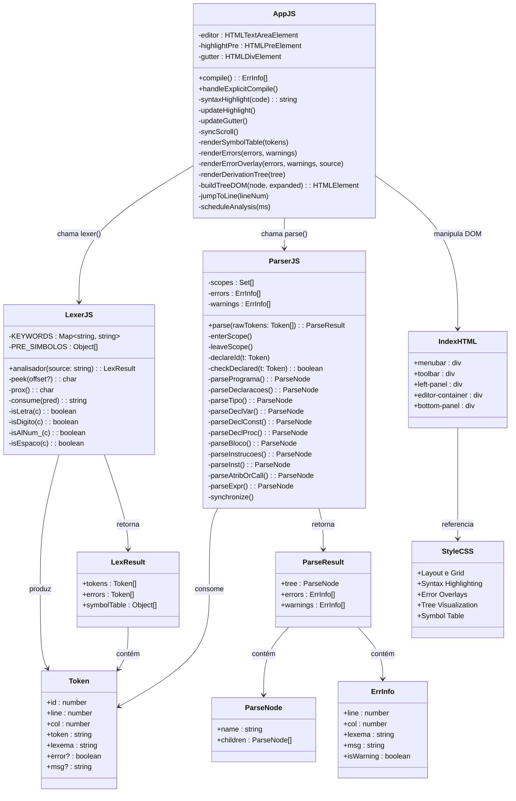
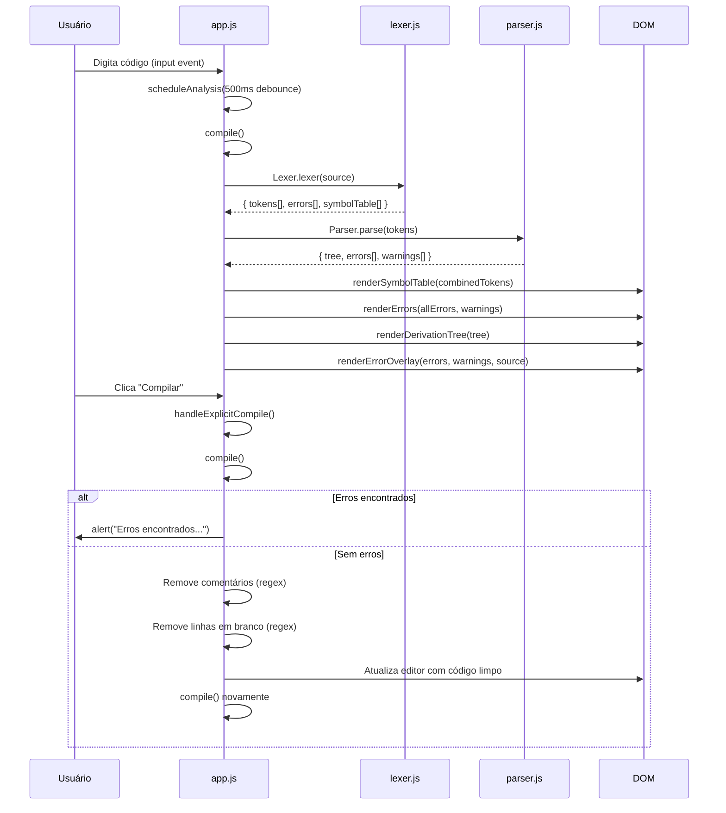
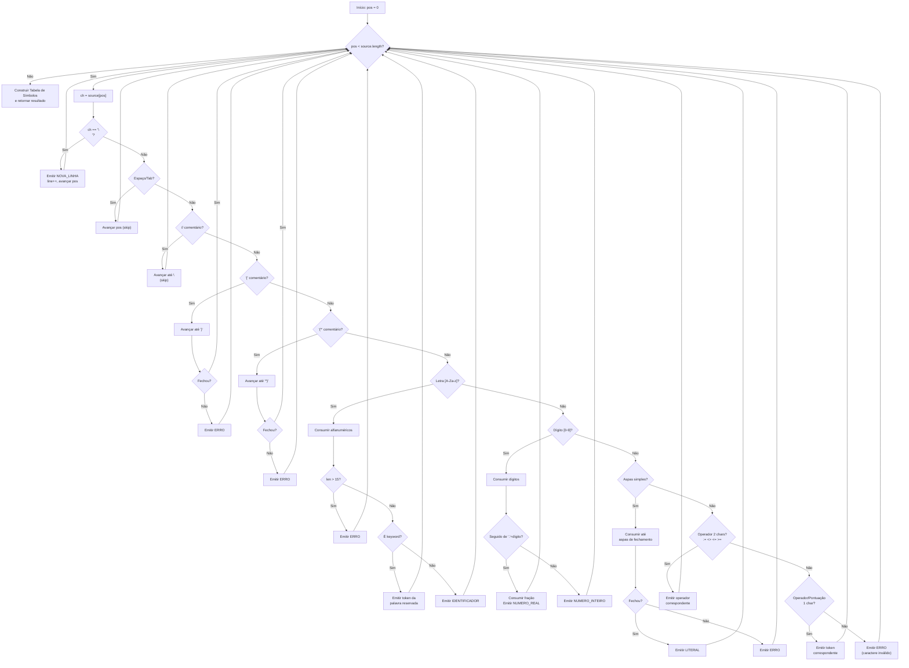

# PascaLex IDE — Documentação do Analisador Léxico e Arquitetura

## 1. Visão Geral

O **PascaLex** é um compilador educacional para um dialeto da linguagem Pascal, executado inteiramente no navegador web. O sistema é composto por três módulos JavaScript independentes que se comunicam através de interfaces bem definidas, além de uma camada de apresentação HTML/CSS.

O pipeline de compilação segue a arquitetura clássica de compiladores:

```
Código-Fonte → Analisador Léxico → Analisador Sintático → Resultados (Árvore, Erros, Tabela de Símbolos)
```

---

## 2. Arquitetura dos Módulos

### 2.1 Diagrama UML de Componentes



### 2.2 Diagrama de Sequência — Pipeline de Compilação



---

## 3. Analisador Léxico (`lexer.js`)

### 3.1 Responsabilidade

O analisador léxico é responsável por transformar o código-fonte (uma string de texto) em uma sequência de **tokens** — as unidades atômicas da linguagem. Ele percorre o texto caractere por caractere, identificando padrões e classificando cada trecho reconhecido.

### 3.2 Estruturas de Dados

#### Token
Cada token produzido possui os seguintes campos:

| Campo    | Tipo      | Descrição                                       |
|----------|-----------|-------------------------------------------------|
| `id`     | `number`  | Identificador sequencial (1, 2, 3, …)           |
| `line`   | `number`  | Linha onde o token foi encontrado (base 1)       |
| `col`    | `number`  | Coluna onde o token inicia (base 1)              |
| `token`  | `string`  | Categoria/tipo do token (ex: `IDENTIFICADOR`)    |
| `lexema` | `string`  | Texto literal extraído do código-fonte           |
| `error`  | `boolean` | `true` se o token representa um erro léxico      |
| `msg`    | `string`  | Mensagem descritiva do erro (quando aplicável)   |

#### Palavras Reservadas (KEYWORDS)

O lexer reconhece **38 palavras reservadas**, armazenadas em um `Map` case-insensitive:

| Categoria          | Palavras                                                           |
|--------------------|--------------------------------------------------------------------|
| Estrutura          | `program`, `begin`, `end`                                          |
| Declarações        | `var`, `const`, `procedure`, `function`                             |
| Controle de Fluxo  | `if`, `then`, `else`, `while`, `do`, `repeat`, `until`, `for`, `to`, `downto` |
| Laço               | `break`, `continue`                                                |
| Tipos              | `integer`, `real`, `char`, `string`                                |
| Operadores Lógicos | `or`, `and`, `not`                                                 |
| Operadores Arit.   | `div`, `mod`                                                       |
| Literais Bool.     | `true`, `false`                                                    |
| Outros             | `record`, `type`, `array`, `of`                                    |
| I/O                | `writeln`, `write`, `readln`, `read`                               |

### 3.3 Categorias de Tokens

O lexer produz tokens nas seguintes categorias:

| Categoria            | Tokens Produzidos                                                             |
|----------------------|-------------------------------------------------------------------------------|
| Palavras Reservadas  | `PROGRAM`, `BEGIN`, `END`, `VAR`, `CONST`, `IF`, `THEN`, `ELSE`, `WHILE`, `DO`, `REPEAT`, `UNTIL`, `FOR`, `TO`, `DOWNTO`, `BREAK`, `CONTINUE`, `PROCEDURE`, `FUNCTION`, `INTEGER`, `REAL`, `CHAR`, `STRING`, `OU`, `E`, `NAO`, `DIV`, `MOD`, `VERDADEIRO`, `FALSO`, `REGISTRO`, `TIPO`, `VETOR`, `DE`, `WRITELN`, `WRITE`, `READLN`, `READ` |
| Identificadores      | `IDENTIFICADOR`                                                               |
| Literais Numéricos   | `NUMERO_INTEIRO`, `NUMERO_REAL`                                               |
| Literais String      | `LITERAL`                                                                     |
| Operadores (2 chars) | `OP_ATRIBUICAO` (`:=`), `OP_DIFERENTE` (`<>`), `OP_MENOR_IGUAL` (`<=`), `OP_MAIOR_IGUAL` (`>=`) |
| Operadores (1 char)  | `OP_IGUAL` (`=`), `OP_MENOR` (`<`), `OP_MAIOR` (`>`), `OP_MAIS` (`+`), `OP_MENOS` (`-`), `OP_MULT` (`*`), `OP_DIV` (`/`) |
| Pontuação            | `PONTO_VIRGULA` (`;`), `DOIS_PONTOS` (`:`), `VIRGULA` (`,`), `PONTO` (`.`), `ABRE_PAR` (`(`), `FECHA_PAR` (`)`), `ABRE_COL` (`[`), `FECHA_COL` (`]`) |
| Controle             | `NOVA_LINHA`                                                                  |
| Erro                 | `ERRO`                                                                        |

### 3.4 Algoritmo de Varredura

O lexer utiliza uma **máquina de varredura caractere-a-caractere** (scanner) com as seguintes funções auxiliares:

- **`peek(offset)`** — Olha o caractere na posição `pos + offset` sem consumir.
- **`prox()`** — Consome e retorna o caractere atual, avançando `pos`.
- **`consume(pred)`** — Consome caracteres enquanto o predicado `pred` for verdadeiro.

O loop principal (`while pos < source.length`) testa o caractere atual contra os seguintes padrões, **nesta ordem de prioridade**:

```
1. Quebra de linha (\n)          → Token NOVA_LINHA
2. Espaço em branco (space/tab)  → Ignorado (skip)
3. Comentário //                 → Ignorado (skip até \n)
4. Comentário { }                → Ignorado (skip até })
5. Comentário (* *)              → Ignorado (skip até *))
6. Letra [A-Za-z]                → Identificador ou Palavra Reservada
7. Dígito [0-9]                  → Número Inteiro ou Real
8. Aspas simples '               → Literal String
9. Operadores de 2 caracteres    → :=  <>  <=  >=
10. Operadores/Pontuação de 1 char → =  <  >  +  -  *  /  ;  :  ,  .  (  )  [  ]
11. Qualquer outro caractere      → Token ERRO
```

### 3.5 Tratamento de Identificadores e Palavras Reservadas

Quando o lexer encontra uma letra `[A-Za-z]`, ele consome todos os caracteres alfanuméricos e underscores subsequentes (`[A-Za-z0-9_]`). O resultado é comparado (em minúsculas) contra o mapa `KEYWORDS`:

- **Se encontrado**: produz um token com o tipo da palavra reservada (ex: `PROGRAM`)
- **Se não encontrado**: produz um token `IDENTIFICADOR`

**Validação**: identificadores com mais de 15 caracteres geram um token `ERRO`.

### 3.6 Tratamento de Números

```
Dígito encontrado → consume dígitos → verifica se próximo é '.'
    Se '.' seguido de dígito → consume parte fracionária → NUMERO_REAL
    Senão → NUMERO_INTEIRO
```

### 3.7 Tratamento de Comentários

O lexer suporta **3 estilos de comentário**, todos ignorados (não geram tokens):

| Estilo     | Abertura | Fechamento | Multilinha? |
|------------|----------|------------|-------------|
| Linha      | `//`     | `\n`       | Não         |
| Chaves     | `{`      | `}`        | Sim         |
| Par.-Ast.  | `(*`     | `*)`       | Sim         |

> [!WARNING]
> Comentários `{ }` e `(* *)` não fechados geram um token `ERRO` com a mensagem descritiva correspondente.

### 3.8 Tabela de Símbolos Pré-definida

O lexer constrói uma tabela de símbolos em duas etapas:

1. **Símbolos pré-definidos** (`PRE_SIMBOLOS`): 57 entradas geradas no carregamento do módulo, contendo todas as palavras reservadas, operadores e sinais de pontuação da linguagem. Cada entrada possui `line: '-'` para indicar que não vem do código-fonte.

2. **Identificadores do programa**: após a varredura, o lexer percorre os tokens gerados e adiciona à tabela cada `IDENTIFICADOR` único (sem duplicatas).

### 3.9 Interface Exportada

```javascript
window.Lexer = {
    lexer: analisador,           // função principal
    KEYWORDS,                    // Map de palavras reservadas
    PREDEFINED_SYMBOLS: PRE_SIMBOLOS  // tabela pré-definida
};
```

---

## 4. Analisador Sintático (`parser.js`)

### 4.1 Responsabilidade

O parser recebe a lista de tokens do lexer e produz:
- Uma **árvore de derivação** (parse tree) representando a estrutura gramatical
- Uma lista de **erros sintáticos e semânticos**
- Uma lista de **avisos** (warnings)

### 4.2 Método de Análise

Utiliza **análise sintática descendente recursiva** (recursive descent parsing), onde cada regra gramatical é implementada como uma função JavaScript.

### 4.3 Gramática Implementada

```
programa        → PROGRAM IDENTIFICADOR ; declarações bloco .
declarações     → { declVar | declConst | declProc }
declVar         → VAR { IDENTIFICADOR { , IDENTIFICADOR } : tipo ; }
declConst       → CONST { IDENTIFICADOR [ : tipo ] = expr ; }
declProc        → (PROCEDURE|FUNCTION) IDENTIFICADOR [ ( params ) ] [ : tipo ] ; [ VAR declVar ] bloco ;
tipo            → INTEGER | REAL | CHAR | STRING | ARRAY
bloco           → BEGIN instruções END
instruções      → { instrução }
instrução       → atribOrCall | if | while | repeat | for | bloco | break ; | continue ; | procCall
atribOrCall     → IDENTIFICADOR ( := expr ; | [expr] := expr ; | (args) ; | ; )
if              → IF expr THEN instrução [ ELSE instrução ]
while           → WHILE expr DO instrução
repeat          → REPEAT { instrução } UNTIL expr ;
for             → FOR IDENTIFICADOR := expr (TO|DOWNTO) expr DO instrução
expr            → logical
logical         → comparação { (OR|AND) comparação }
comparação      → addSub { (=|<>|<|<=|>|>=) addSub }
addSub          → mulDiv { (+|-) mulDiv }
mulDiv          → unário { (*|/|DIV|MOD) unário }
unário          → [-|+|NOT] fator
fator           → ( expr ) | IDENTIFICADOR [ [expr] | (args) ] | literal
```

### 4.4 Análise Semântica (Escopo de Variáveis)

O parser mantém uma **pilha de escopos** (`scopes: Set[]`) para rastrear declarações:

- **`enterScope()`** — Empilha um novo escopo (ao entrar em procedure/function)
- **`leaveScope()`** — Desempilha o escopo atual
- **`declareId(t)`** — Registra um identificador no escopo atual
- **`checkDeclared(t)`** — Busca o identificador em todos os escopos (do mais interno para o mais externo). Se não encontrado, emite o erro *"Variável não declarada"*

### 4.5 Verificação de Tipos

A função `parseTipo()` valida que o tipo declarado é um dos tipos nativos da linguagem (`integer`, `real`, `char`, `string`, `array`). Identificadores usados como tipo geram o erro *"Tipo válido esperado"*.

### 4.6 Recuperação de Erros (Panic Mode)

Quando um erro é encontrado, o parser utiliza a função **`synchronize()`** para avançar tokens até encontrar um ponto de sincronização seguro (`;`, `end`, `begin`, `if`, `while`, `repeat`, `for`, `procedure`, `function`), permitindo que a análise continue e detecte **múltiplos erros** em uma única passada.

### 4.7 Interface Exportada

```javascript
window.Parser = { parse: parse };
// parse(rawTokens) → { tree: ParseNode, errors: ErrInfo[], warnings: ErrInfo[] }
```

---

## 5. Controlador da IDE (`app.js`)

### 5.1 Sistema de Camadas do Editor

O editor utiliza **3 camadas sobrepostas** com sincronização de scroll:

| z-index | Elemento        | Função                                              |
|---------|-----------------|-----------------------------------------------------|
| 1       | `#highlight-pre`| `<pre>` com spans coloridos (syntax highlighting)    |
| 2       | `#error-pre`    | `<pre>` com spans de sublinhado ondulado (erros)     |
| 3       | `#editor`       | `<textarea>` transparente (entrada do usuário)       |

### 5.2 Fluxo de Compilação

#### Compilação Automática (debounced)
A cada digitação, `scheduleAnalysis()` agenda uma chamada a `compile()` após 500ms de inatividade.

#### Compilação Explícita (botão "Compilar")
`handleExplicitCompile()` executa o pipeline completo e, se não houver erros:
1. Remove comentários (`//`, `{ }`, `(* *)`) via regex
2. Remove espaços em branco no final das linhas
3. Remove linhas totalmente em branco
4. Atualiza o editor e recompila

### 5.3 Renderização

- **Tabela de Símbolos**: combina `PREDEFINED_SYMBOLS` (fundo cinza) + tokens do código. Auto-scroll para a primeira entrada do código-fonte.
- **Painel de Erros**: lista erros (vermelho) e warnings (amarelo/laranja) clicáveis.
- **Overlay de Erros**: sublinhado ondulado vermelho (`err-squiggle`) e laranja (`warn-squiggle`).
- **Árvore de Derivação**: árvore DOM colapsável/expandível.

---

## 6. Diagrama de Fluxo do Analisador Léxico



---

## 7. Estrutura de Arquivos

```
pascalex/
├── index.html     → Estrutura HTML da IDE (menus, painéis, editor)
├── style.css      → Estilos visuais (layout, cores, fontes, overlays)
├── lexer.js       → Analisador Léxico (scanner character-by-character)
├── parser.js      → Analisador Sintático (recursive descent parser)
└── app.js         → Controlador da IDE (pipeline, rendering, eventos)
```
